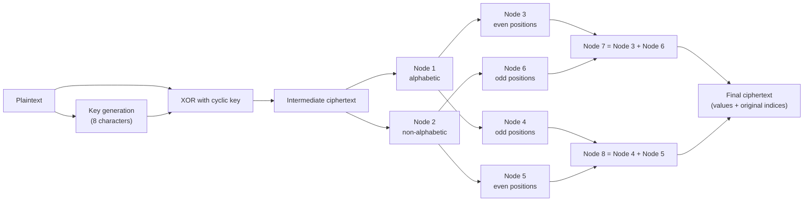

# Information Security Using Artificial Neural Network

**B.Sc. (Honours) Computer Science project** — *A Survey on Information Security Using Artificial Neural Network*

A symmetric-key encryption and decryption heuristic organised as a feed-forward network of eight processing nodes, implemented in Python with a Streamlit web demo, a command-line tool, automated tests, Docker support and CI.

| | |
|---|---|
| **Authors** | Arka Maity, Debjit Dey, Shouvik Sarkar |
| **Supervisor** | Dr. Soumya Paul |
| **Institution** | Ramakrishna Mission Vivekananda Centenary College, Rahara, Khardaha, West Bengal 700118 |
| **Programme** | B.Sc. (Hons) Computer Science, Semester VI (paper code CMSA DSE-VI) |
| **Report** | April 2024 — [docs/project-report.pdf](docs/project-report.pdf) |

> **Educational project, not production cryptography.** The algorithm is a custom XOR-and-rearrangement heuristic. Do not use it to protect passwords, financial or medical data, API keys or any other real secret. See [Limitations](#limitations).

## Abstract

Ensuring information security in long-distance transmissions across computer networks is difficult. The project studies how artificial neural networks (ANNs) can help and develops a symmetric-key cryptographic system on a feed-forward neural architecture, aimed at data confidentiality and message authentication during transmission.

**Keywords:** information security · artificial neural networks · feed-forward neural network · symmetric-key cryptography · data confidentiality · message authentication · long-distance transmission · network resilience

## Objectives and status

| Objective in the report | Status in this repository |
|---|---|
| **Enhanced data confidentiality** — a dynamic, unpredictable encryption process | Implemented as key-dependent XOR followed by a fixed eight-node rearrangement. The process is deterministic and of educational strength only. |
| **Robust message authentication** — verify the origin and prevent tampering | Not implemented, neither in the report's code nor here. |
| **Long-distance network resilience** — delays and varying packet sizes | Messages of any length work and the ciphertext is a printable ASCII token. There is no networking code. |

## How it works



1. **Key generation** — the key has 8 characters: absolute differences between neighbouring character codes of the message's first 8 characters (the message is repeated if it is shorter).
2. **Input layer** — every character is XOR-ed with the cyclic key, giving the intermediate ciphertext.
3. **Hidden layer** — Node 1 and Node 2 hold the alphabetic and non-alphabetic values; Nodes 3 to 6 are their even and odd positions; Node 7 = Node 3 + Node 6 and Node 8 = Node 4 + Node 5.
4. **Output layer** — Node 7 + Node 8 is the final ciphertext. Every value keeps its original index.
5. **Decryption** — sort the values by index, then XOR with the key again.

The nodes are fixed processing steps; nothing is trained. [docs/algorithm.md](docs/algorithm.md) has the details, a complete worked example, the report's sample runs and a list of differences between the report's hand-worked example and its source code.

Example run:

```text
$ python -m src.cli demo "Namaste India!"
Generated key (hex): 2e130c0c12010f45
Generated key (chars): .\x13\x0c\x0c\x12\x01\x0fE
Intermediate ciphertext: `ramaujeg}hes
Final ciphertext: rmuehs}aajge`
Ciphertext token: eyJ2ZXJzaW9uIjoxLCJhbGdvcml0aG0iOiJCU2MtQU5OLWluZm9ybWF0aW9uLXNlY3VyaXR5LWhldXJpc3RpYyIsImNpcGhlcnRleHQiOlsxMTQsMTA5LDExNywxMDEsMTA0LDExNSwxMjUsOTcsOTcsMTA2LDEwMywxMDEsOTYsMzJdLCJpbmRpY2VzIjpbMSwzLDUsNywxMCwxMiw5LDIsNCw2LDgsMTEsMCwxM119
Decrypted: Namaste India!
```

Generated keys usually contain control characters, so they are printed and entered as hexadecimal text. The token holds only the cipher values and their indices; the key has to be shared separately.

## Quick start

### 1. Clone

```bash
git clone https://github.com/<your-username>/ann-information-security-cryptography.git
cd ann-information-security-cryptography
```

### 2. Create a virtual environment

Windows:

```bash
python -m venv .venv
.venv\Scripts\activate
```

Linux/macOS:

```bash
python3 -m venv .venv
source .venv/bin/activate
```

### 3. Install dependencies

```bash
pip install -r requirements.txt
```

### 4. Run the web app

```bash
streamlit run app/streamlit_app.py
```

Open the URL shown by Streamlit, normally `http://localhost:8501`. The **Encrypt** tab shows the key, the intermediate and final ciphertext, the token and the eight nodes; **Decrypt** takes a token and a hexadecimal key.

### 5. Use the command line

```bash
python -m src.cli                            # interactive menu
python -m src.cli demo "Namaste India!"      # encrypt and decrypt, like the report's program
python -m src.cli encrypt "Namaste India!"   # print the key (hex) and the token
python -m src.cli decrypt TOKEN KEY_HEX      # recover the plaintext
```

### 6. Use it from Python

```python
from src.crypto_system import decrypt, encrypt, key_from_hex

result = encrypt("Namaste India!")
result["key_hex"]    # '2e130c0c12010f45' - share separately from the token
result["token"]      # printable ciphertext: values + indices, no key
decrypt(result["token"], key_from_hex(result["key_hex"]))   # 'Namaste India!'
```

## Tests

```bash
pytest -q
```

The suite covers key generation, the eight nodes, token validation, hexadecimal keys, round trips (including Unicode and control characters), the command-line tool and the web app. It also checks that the code reproduces the three console runs printed in the report and agrees with the report's original source code (`tests/report_reference.py`) on random messages. GitHub Actions runs it on every push.

## Deploy on Streamlit Community Cloud

1. Push this repository to GitHub.
2. Open Streamlit Community Cloud and select **New app**.
3. Choose this repository and set the main file to `app/streamlit_app.py`.
4. Deploy. No API key or secret is required.

The app has no compiled dependencies (only `streamlit` itself, plus the
Python standard library), so it is not picky about the Python version
Community Cloud gives it. If a specific version is ever needed, pick it
from **Advanced settings** in the deploy dialog — Community Cloud does not
currently read `runtime.txt` or `.python-version` for this.

## Deploy with Docker

```bash
docker build -t ann-information-security .
docker run --rm -p 8501:8501 ann-information-security
```

Then open `http://localhost:8501`.

The image also works on PaaS hosts that inject their own `PORT` (Render,
Railway, Fly.io, Heroku's container runtime, Cloud Run, ...): the container
listens on `$PORT` when it is set and falls back to 8501 otherwise, so no
Dockerfile changes are needed — just point the platform at this repository
and, if it asks, tell it the app listens on `$PORT`.

## Repository structure

```text
.
├── app/
│   └── streamlit_app.py        Streamlit web demo
├── docs/
│   ├── algorithm.md            algorithm, worked example, report vs. code, limitations
│   ├── project-report.pdf      the B.Sc. project report
│   └── survey.md               background, literature survey, applications, bibliography
├── src/
│   ├── __init__.py
│   ├── cli.py                  command-line tool
│   └── crypto_system.py        key generation, encryption, decryption
├── tests/
│   ├── report_reference.py     the report's original source code, used as a test reference
│   ├── test_app.py
│   ├── test_cli.py
│   └── test_crypto_system.py
├── .github/workflows/tests.yml
├── .python-version              Python version for CI / pyenv / asdf
├── .streamlit/config.toml
├── Dockerfile                   respects $PORT, falls back to 8501
├── PROJECT_INFO.md             objectives, SRS, schedule, tools, testing, future scope
├── pytest.ini
├── requirements.txt
├── runtime.txt                  legacy Heroku-style pin, kept for older platforms
└── README.md
```

## Limitations

- The key is derived from the first 8 characters of the message and must be sent separately. A message that starts with one repeated character (for example `aaaa`) gives an all-zero key, and XOR then changes nothing.
- An 8-character repeating XOR key falls to standard frequency and known-plaintext attacks. The node rearrangement is a fixed public permutation whose indices travel with the ciphertext, so it adds no strength.
- There is no authentication or integrity check: a wrong key or a modified token is not detected.
- The "neural network" is a fixed data-flow of eight nodes with no learning step.

More in [docs/algorithm.md](docs/algorithm.md#9-limitations). For real applications use a vetted library and an authenticated cipher such as AES-GCM.

## Future scope

From the report:

- Add asymmetric cryptography as a basis for secure communication between the parties involved.
- Build more complex mathematical functions into the network architecture.
- Generate nodes dynamically so that the network can adapt its structure while it runs.

## Further reading

- [PROJECT_INFO.md](PROJECT_INFO.md) — objectives, requirements, feasibility, schedule, tools and testing.
- [docs/survey.md](docs/survey.md) — ANN background, literature survey, applications and bibliography.

## License

No license file has been added yet, so all rights remain with the authors. The authors should agree on a license (and check the college's rules) before adding a `LICENSE` file and making the repository public.
