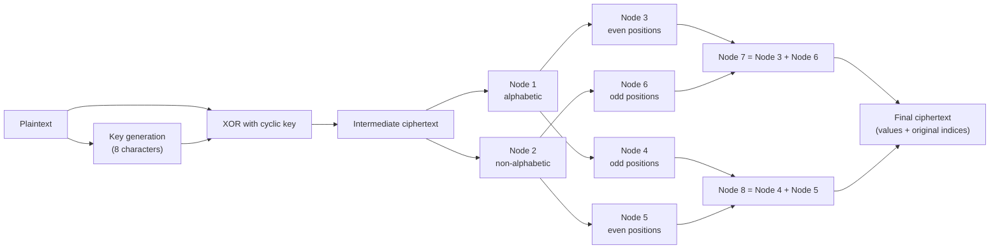
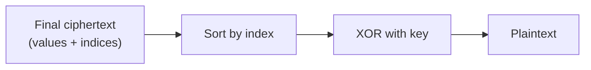

# Algorithm

This page describes the encryption heuristic of the project report as it is implemented in [`src/crypto_system.py`](../src/crypto_system.py), walks through one complete example, and lists where the repository differs from the report. Every value on this page is generated by the code and checked by `tests/test_crypto_system.py`.

Contents: [1. Overview](#1-overview) · [2. Key generation](#2-key-generation) · [3. Encryption](#3-encryption) · [4. Ciphertext token](#4-ciphertext-token) · [5. Decryption](#5-decryption) · [6. Worked example](#6-worked-example) · [7. Sample runs from the report](#7-sample-runs-from-the-report) · [8. Report and repository](#8-report-and-repository) · [9. Limitations](#9-limitations)

## 1. Overview

The report presents the design as a small feed-forward network: an **input layer** (key generation and XOR), a **hidden layer** of eight nodes and an **output layer** (the final ciphertext). The nodes are fixed processing steps; nothing is trained.



Decryption uses the stored indices to undo the rearrangement and then applies the XOR again:



| Term | Meaning |
|---|---|
| Key | 8 characters derived from the plaintext (section 2) |
| Intermediate ciphertext | plaintext XOR key |
| Value/index pair | a ciphertext value together with its position in the original message |
| Final ciphertext | the value/index pairs after the node rearrangement |

## 2. Key generation

1. Repeat the plaintext until it covers 8 characters (`KEY_LENGTH = 8`) and keep the first 8 characters.
2. Take their character codes `c[0] ... c[7]`.
3. `key[i] = chr(abs(c[i] - c[i-1]))` for `i = 0 ... 7`. For `i = 0` the "previous" character is `c[7]` (Python's `c[-1]`), exactly as in the report's source code.

The key depends only on the first 8 characters of the message and has to be given to the receiver separately. Keys usually contain control characters (NUL, line feed, ...), so the command-line tool and the web app print and accept them as hexadecimal text (`key_to_hex` / `key_from_hex`).

## 3. Encryption

1. **XOR (input layer).** `value[i] = code(plaintext[i]) XOR code(key[i mod 8])`. The results form the intermediate ciphertext. Values stay integers, so control characters need no special handling.
2. **Node 1 and Node 2.** Node 1 keeps the values whose character is alphabetic (`str.isalpha()`), Node 2 keeps the rest. Both keep the original order and the original index of every value.
3. **Nodes 3 to 6.** Node 3 and Node 4 are the even and odd positions (0, 2, 4, ... and 1, 3, 5, ...) of Node 1; Node 5 and Node 6 are the even and odd positions of Node 2. "Position" means the position *inside* Node 1 or Node 2, not the index in the message.
4. **Nodes 7 and 8.** Node 7 = Node 3 followed by Node 6. Node 8 = Node 4 followed by Node 5.
5. **Output layer.** The final ciphertext is Node 7 followed by Node 8.

## 4. Ciphertext token

`encrypt()` returns the final ciphertext as two lists, `cipher_values` and `indices`, and as a printable token: the base64url encoding of

```json
{"version": 1, "algorithm": "BSc-ANN-information-security-heuristic", "ciphertext": [...], "indices": [...]}
```

The key is never part of the token; it has to be shared separately. The token is plain ASCII, so it can be sent through any text channel and has no length limit other than the message length.

## 5. Decryption

1. Decode the token and sort the values by their indices. This undoes Nodes 1 to 8 and gives back the intermediate ciphertext.
2. XOR every value with the cyclic key.

`decrypt()` raises `ValueError` for malformed tokens (bad encoding, wrong version, missing or duplicate indices, ...). It cannot detect a wrong key: without authentication the result is simply unreadable text.

## 6. Worked example

Plaintext: `Namaste India!`

Key generation:

```text
key part = 'Namaste '   (first 8 characters)
codes    = [78, 97, 109, 97, 115, 116, 101, 32]

 i   (c[i], c[i-1])   abs difference   key byte
 0   ( 78,  32)         46              0x2e
 1   ( 97,  78)         19              0x13
 2   (109,  97)         12              0x0c
 3   ( 97, 109)         12              0x0c
 4   (115,  97)         18              0x12
 5   (116, 115)          1              0x01
 6   (101, 116)         15              0x0f
 7   ( 32, 101)         69              0x45

key (hex) = 2e130c0c12010f45
```

XOR (input layer):

```text
 i  char   code  key   XOR  result
 0  'N'     78  0x2e   96  '`'
 1  'a'     97  0x13  114  'r'
 2  'm'    109  0x0c   97  'a'
 3  'a'     97  0x0c  109  'm'
 4  's'    115  0x12   97  'a'
 5  't'    116  0x01  117  'u'
 6  'e'    101  0x0f  106  'j'
 7  ' '     32  0x45  101  'e'
 8  'I'     73  0x2e  103  'g'
 9  'n'    110  0x13  125  '}'
10  'd'    100  0x0c  104  'h'
11  'i'    105  0x0c  101  'e'
12  'a'     97  0x12  115  's'
13  '!'     33  0x01   32  ' '

intermediate ciphertext = '`ramaujeg}hes '
```

Hidden layer, as lists of (value, original index):

```text
Node 1  alphabetic values
  [('r', 1), ('a', 2), ('m', 3), ('a', 4), ('u', 5), ('j', 6), ('e', 7), ('g', 8), ('h', 10), ('e', 11), ('s', 12)]
Node 2  non-alphabetic values
  [('`', 0), ('}', 9), (' ', 13)]
Node 3  Node 1, even positions
  [('r', 1), ('m', 3), ('u', 5), ('e', 7), ('h', 10), ('s', 12)]
Node 4  Node 1, odd positions
  [('a', 2), ('a', 4), ('j', 6), ('g', 8), ('e', 11)]
Node 5  Node 2, even positions
  [('`', 0), (' ', 13)]
Node 6  Node 2, odd positions
  [('}', 9)]
Node 7  Node 3 + Node 6
  [('r', 1), ('m', 3), ('u', 5), ('e', 7), ('h', 10), ('s', 12), ('}', 9)]
Node 8  Node 4 + Node 5
  [('a', 2), ('a', 4), ('j', 6), ('g', 8), ('e', 11), ('`', 0), (' ', 13)]
```

Output layer:

```text
final ciphertext (Node 7 + Node 8, value/index pairs)
  [('r', 1), ('m', 3), ('u', 5), ('e', 7), ('h', 10), ('s', 12), ('}', 9), ('a', 2), ('a', 4), ('j', 6), ('g', 8), ('e', 11), ('`', 0), (' ', 13)]

final ciphertext as text
  'rmuehs}aajge` '
```

Token (the key is not inside):

```text
eyJ2ZXJzaW9uIjoxLCJhbGdvcml0aG0iOiJCU2MtQU5OLWluZm9ybWF0aW9uLXNlY3VyaXR5LWhldXJpc3RpYyIsImNpcGhlcnRleHQiOlsxMTQsMTA5LDExNywxMDEsMTA0LDExNSwxMjUsOTcsOTcsMTA2LDEwMywxMDEsOTYsMzJdLCJpbmRpY2VzIjpbMSwzLDUsNywxMCwxMiw5LDIsNCw2LDgsMTEsMCwxM119
```

Decryption with key `2e130c0c12010f45`:

```text
sorted by index -> '`ramaujeg}hes '   (the intermediate ciphertext)
XOR with key    -> 'Namaste India!'
```

## 7. Sample runs from the report

The report prints three console runs (pp. 27-28). The repository produces the same key, intermediate ciphertext and final ciphertext; the visible characters are compared in `test_report_sample_outputs`. Non-printable characters are shown as `\xNN` escapes here (the report's screenshots show them as boxes).

```text
plaintext           : Hello Everyone! Welcome to our project.
key (hex)           : 2e1d0700034f2531
intermediate text   : fxkllo`GKo~om*\x04\x11yxkcl"@\x11Zr'ov=\x05A\rme`;\x0b
final ciphertext    : fklGomxcZoAm~\x04"\x11=\;xloKoyklrvre`*\x11@'\x05`\x0b

plaintext           : May everyone stay happy.
key (hex)           : 251418594511110d
intermediate text   : huay gt\x7f\{v<ebel\4p85ah#
final ciphertext    : hagvbla\x7f{\8#uyteeph \<45

plaintext           : Can you please look into it? It's very urgent!
key (hex)           : 231e0d4e590a0655
intermediate text   : `\x7fcn esuSrh/*o&9Lqfn0dr:\x03wyqyCrrP>{++s& Qyh -+
final ciphertext    : ceuroqnryyrPQh\x7f/&0\x03{+ -nsShLfdwqCrsy` *9:>+& +
```

`tests/report_reference.py` contains the report's original source code, and a second test checks that this program and `src/crypto_system.py` agree on the three samples and on 300 random messages.

## 8. Report and repository

The report contains a hand-worked example (pp. 23-26) and a source-code listing (pp. 33-38). They are not identical, and the repository follows the listing and the console output where they differ:

| Topic | Report | This repository |
|---|---|---|
| Key generation | The worked example uses `(c[i] - c[i+1]) mod 95` over forward pairs and ends up with the key `4c530c4d5c0f4531` (hex). The heuristic text and the source code use absolute differences. | Absolute differences, `abs(c[i] - c[i-1])`, as in the source code and the printed console output; `Namaste India!` gives `2e130c0c12010f45`. |
| XOR values | Several results in the hand-worked example differ from the correct values (for example 97 XOR 83 is 50; the report lists 14). | Values come from the code and are asserted in the tests. |
| Even/odd grouping | The text speaks of even/odd *indices*, and the example puts `l` (index 10) in the odd group. | Even/odd *position* inside Node 1 / Node 2, as in the source code. |
| Non-printable results | Step 6 says to replace them with `^`; the source code replaces them with NUL and keeps the original plaintext characters in `skipped_chars`. | No replacement. XOR results stay integers, so no plaintext character is stored next to the ciphertext. |
| Decryption | The heuristic sorts by index and reverses the XOR. The source-code `decrypt()` ignores the final ciphertext and rebuilds the plaintext from `combined_chars` and `skipped_chars`. | Follows the heuristic: the token holds values and indices, decryption sorts by index and XORs with the key. |
| NUL characters | Replaced by `<NULL>` before encryption. | Not needed; NUL is treated like any other character. |
| Output | Console text with unprintable characters. | `render()` for display and a base64url token for transport. |
| Message authentication | An objective in the abstract; no code. | Not implemented (see below). |
| Neural network | Eight-node feed-forward diagram; no learning step. | The same node structure; no learning step. |

## 9. Limitations

This is a teaching implementation. Do not use it to protect real data.

- **Weak key derivation.** The key comes from the first 8 characters of the message, so the sender has to transmit it separately. Messages that start with one repeated character (for example `aaaa`) produce an all-zero key and XOR changes nothing.
- **Repeating-key XOR.** An 8-character key that repeats is broken by standard frequency and known-plaintext attacks.
- **No secret in the rearrangement.** The eight-node rearrangement is a fixed, public permutation, and the indices travel with the ciphertext, so it adds no cryptographic strength.
- **No authentication or integrity check.** A modified token or a wrong key is not detected. The report lists message authentication as an objective, but neither the report's code nor this repository implements it.
- **Not a trained neural network.** The "neurons" are deterministic steps.

For real applications use a vetted library and an authenticated cipher such as AES-GCM or ChaCha20-Poly1305.
